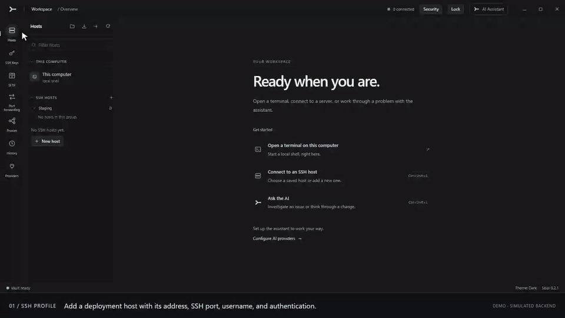
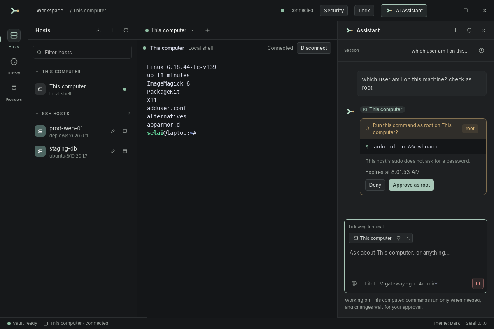
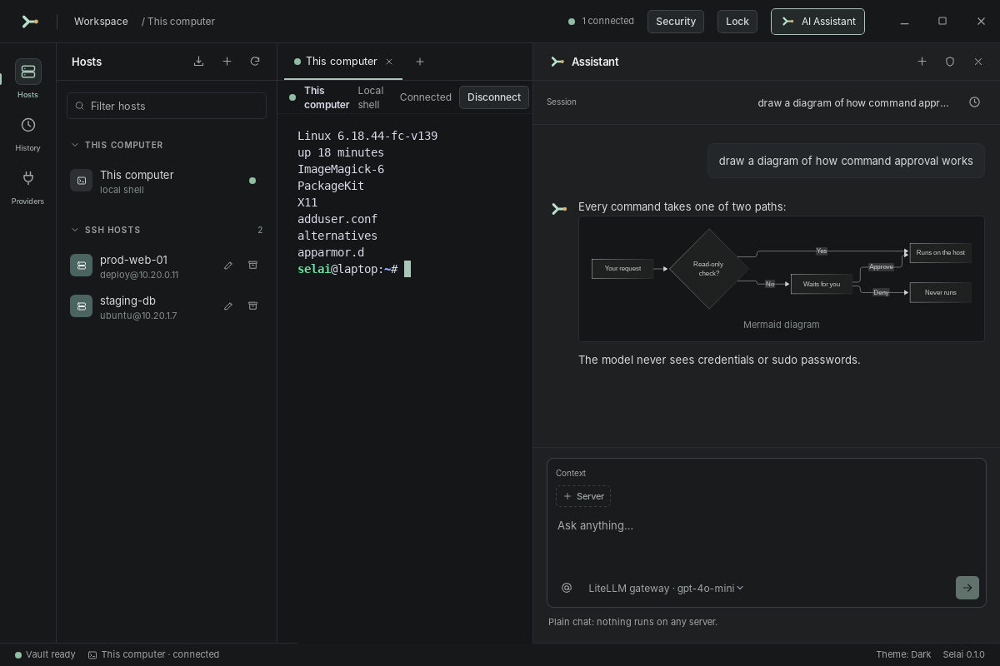
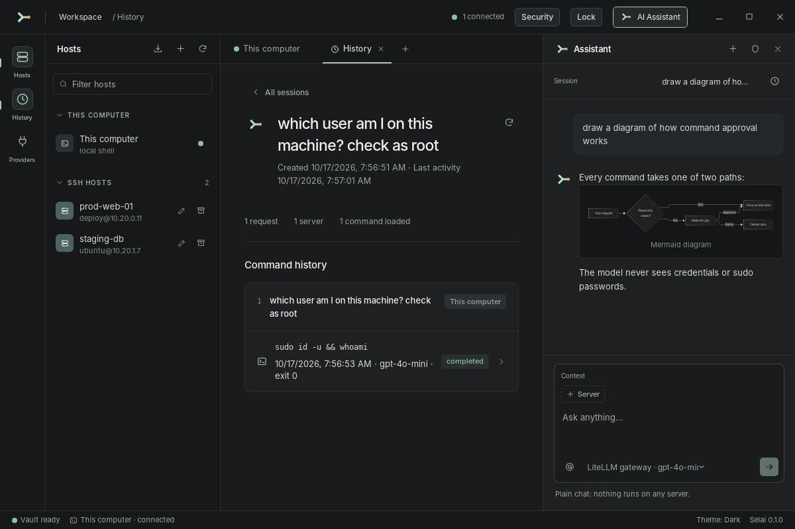
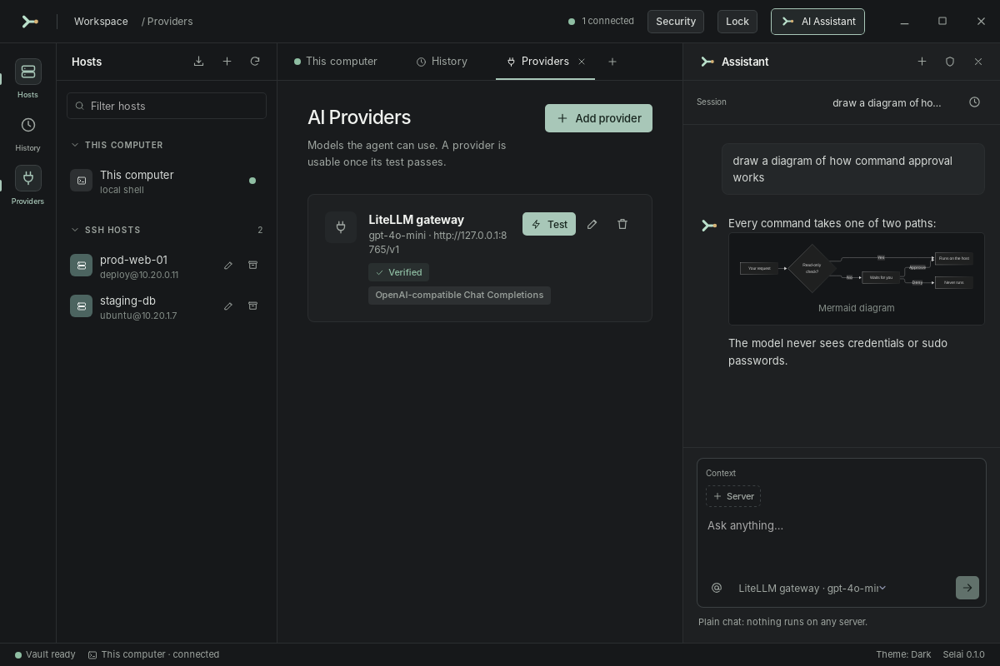
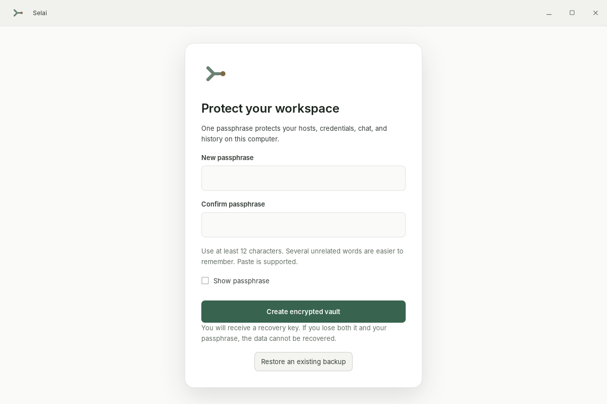
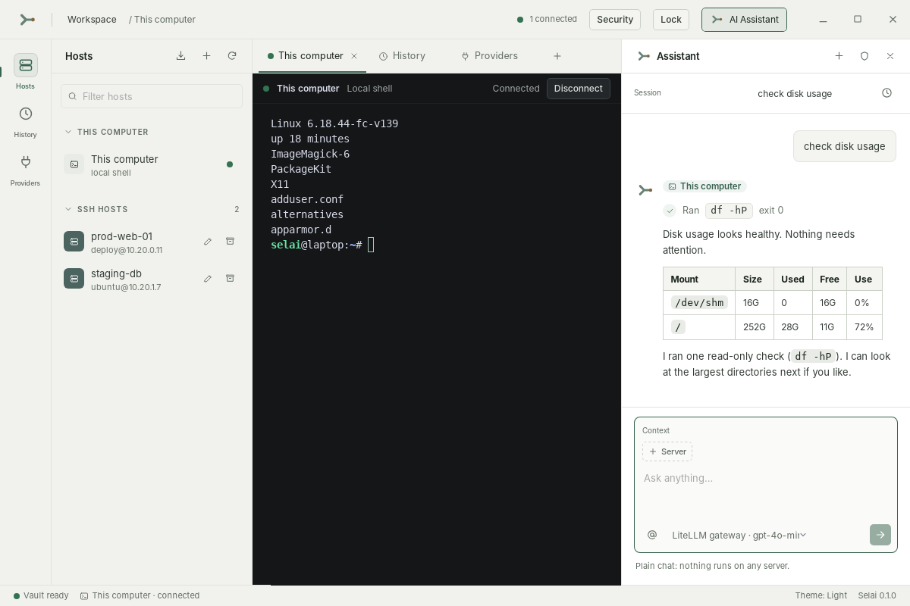

<p align="center"></p>

<h1 align="center">Selai</h1>

<p align="center"><strong>A desktop SSH workbench with a host-scoped AI assistant.</strong><br>
Terminals, an AI chat, and command history in one app. You choose where the assistant may work and approve its commands, with optional root approval for one request on one host.</p>

<p align="center"><sub>Preview 0.2.0 · Apache 2.0 · Windows, Linux, and macOS · Tauri 2, Rust, and React</sub></p>

<p align="center">
  <a href="#quick-demo">Demo</a> ·
  <a href="#screenshots">Screenshots</a> ·
  <a href="#features">Features</a> ·
  <a href="#get-started">Get started</a> ·
  <a href="#build-from-source">Build</a> ·
  <a href="#documentation">Docs</a>
</p>

<p align="center">
  
</p>

<p align="center">59-second looping demo · English captions · Dark mode · <a href="docs/media/selai-ssh-ai-demo.mp4?raw=true">Download full-resolution MP4</a></p>

Selai brings SSH hosts, terminal tabs, an AI chat, and command history into one
desktop app. You choose the machine the assistant may work on. Routine
diagnostics use fixed commands; other commands need approval before they run.
For a multi-step root task, you can approve further root commands for that
request on that host. SSH credentials stay in your passphrase-protected local vault and are
never included in requests to an AI provider.

- **You choose the machine.** A task is bound to the servers you select, or to
  This computer. The model cannot move it to another host.
- **You control execution.** Fixed diagnostics run on their own. Other commands
  show their exact text and target for approval. You can allow further root
  commands within one request on one host.
- **Credentials stay local.** Passwords, private keys, and sudo passwords never
  reach the AI provider. They live in an encrypted vault that one passphrase unlocks.
- **Everything is recorded.** Each request, command, outcome, and token count is
  saved to History, with an audit record written before remote execution.

> **Version 0.2.0 is a preview.** Automated coverage includes Linux SSH and agent
> flows with an OpenSSH fixture and mock AI providers, plus Windows encryption
> and vault checks in the release build profile. Full interactive SSH and live
> provider coverage across all platforms is not established. See [current milestone evidence](docs/release/milestones.md)
> and [known security limits](SECURITY.md) before using Selai with sensitive
> systems.

## Quick demo

The animated walkthrough above shows how to add an SSH profile, review the
server fingerprint, connect to the terminal, then select the
host in AI Assistant, review a proposed command, approve it, and inspect the result.

[Download the full-resolution MP4](docs/media/selai-ssh-ai-demo.mp4?raw=true)
for playback with video controls.

The video records Selai's frontend with simulated SSH and AI responses; it does
not contact a live server. The AI provider is already configured for this demo.
[English subtitles](docs/media/selai-ssh-ai-demo.en.srt) are also available.

## Screenshots

<table>
  <tr>
    <td width="50%" valign="top">
      
      <br><strong>Approve before it runs</strong><br>
      A command that is not a fixed diagnostic shows its exact text and target. Root requests are marked, and a sudo password goes to the machine, never to the model.
    </td>
    <td width="50%" valign="top">
      
      <br><strong>Replies that read well</strong><br>
      Markdown, tables, and Mermaid diagrams render in the chat. Chat with no server selected runs nothing and contacts no host.
    </td>
  </tr>
  <tr>
    <td width="50%" valign="top">
      
      <br><strong>History you can audit</strong><br>
      Open a session to see its requests, the commands that ran on each server, their status and exit codes, and token usage.
    </td>
    <td width="50%" valign="top">
      
      <br><strong>Bring your own model</strong><br>
      Use OpenAI, Anthropic, or a compatible gateway. <strong>Test</strong> checks a real tool-call round trip before a provider can work on a server.
    </td>
  </tr>
  <tr>
    <td width="50%" valign="top">
      
      <br><strong>Encrypted vault</strong><br>
      One passphrase protects hosts, credentials, chat, and history on this computer. Selai generates a separate recovery key during setup.
    </td>
    <td width="50%" valign="top">
      
      <br><strong>Dark, light, or system</strong><br>
      Switch the theme from the status bar. Chats are saved as named sessions you can search and reopen.
    </td>
  </tr>
</table>

<sub>Screenshots use sample hosts and a mock AI provider.</sub>

## Features

| Area | What you can do |
| --- | --- |
| **SSH hosts** | Add, edit, filter, and archive profiles; organize them in collapsible groups; use a password or choose a managed SSH key; save a host and connect in one flow. Reveal a saved login password on demand from the profile editor. Labels can contain spaces. |
| **SSH keys** | Generate named Ed25519, RSA (2048/3072/4096/8192 bits), or ECDSA P-256/P-384/P-521 key pairs; import existing keys with an optional passphrase; copy public keys and reuse a key across profiles. RSA login uses SHA-2 signatures. Private keys stay in the encrypted vault. |
| **SFTP** | Browse local and remote folders side by side, upload/download files and folders recursively, and see progress, speed, remaining time, skips, failures, and cancellation. New-folder, rename, and empty-folder/file deletion are available in either panel. |
| **Port forwarding** | Save and start local, remote, or dynamic SOCKS5 TCP tunnels from a UI. Choose an SSH host, bind address/port and destination, then inspect active connections and byte counts. |
| **SSH proxies** | Save HTTP CONNECT or SOCKS5 profiles with optional authentication, then enable a proxy on any SSH profile. Terminal, AI, SFTP, forwarding and host-key checks use that route. |
| **Host verification** | Inspect and explicitly trust a fingerprint on first connection. A changed host key blocks connection until you confirm its replacement. |
| **Terminal** | Open interactive SSH terminals in tabs, resize them, adjust the terminal font with Ctrl+Plus or Ctrl+Minus, see connection and exit status, reconnect, and edit a host after a failed login. Open a terminal for **This computer** too. |
| **AI chat** | Discuss a question without a server, or bind a task to one or more SSH hosts or This computer. Mention hosts with `@` for one message to run independent tasks in parallel, follow the focused terminal, or pin a server in the chat. Each host has its own output and change approvals. Assistant replies render Markdown, tables, task lists, code blocks, and Mermaid diagrams. |
| **Command control** | Fixed diagnostics may run without a prompt. Other commands need approval; a root approval can optionally cover further root commands in the same request on the same host. Denied, expired, and interrupted work is not replayed automatically. |
| **Providers** | Configure OpenAI Responses, OpenAI Chat Completions and compatible endpoints, or Anthropic Messages. Check an API key, choose or enter a model ID, and test a real tool-call round trip. |
| **History** | Search saved AI sessions by title, then open a session to review its requests and command executions across servers, including status, exit codes and stored output. Browse by host for older tasks, provider token counts, timeline filters, encrypted history exports and output retention. |
| **Profile import** | Preview CSV, JSON, password-protected KDBX, or OpenSSH config profiles before import. Upload a config file or read `~/.ssh/config` directly. Use the shared CSV template for exports from other tools. Existing hosts are not replaced. |
| **Workbench** | Use the host explorer, terminal and History/Providers tabs, and the assistant side by side. Toggle the right-hand Assistant panel from the header and drag its divider to give it more room. The window controls are integrated into the workbench header. Choose dark, light, or system theme. |
| **Encrypted vault** | Protect credentials, managed private keys, host metadata, chat, and history with one passphrase. Use automatic locking, a separate recovery key, encrypted backup/restore, and encrypted history exports. |

### SSH hosts and terminals

Create a profile with a label, address, port, username, and authentication
method. Passwords and key passphrases are saved inside the encrypted vault.
For **Private key** authentication, choose a saved key from the **SSH key**
selector. Use **SSH Keys** in the left sidebar to generate or import keys;
the profile's **Add SSH key / Manage SSH keys** button opens the same page and
keeps your unsaved profile draft. Selai asks you to
trust an unknown server key *before* sending credentials. It refuses a changed
key until you inspect and explicitly replace the saved fingerprint.

Each terminal tab stays bound to its host. The host explorer also includes
**This computer** for a local terminal. Terminal tabs report connection state
and close automatically when the shell exits (`exit`), releasing the
session. If login fails, the tab stays open for retry or editing the profile.

In the profile editor, click the **eye** beside Password to view the stored
login password while the vault is unlocked. The preview clears when hidden,
after 30 seconds, on loss of focus, when vault locking starts, or when the editor closes. Viewing the value
does not replace it when saving; type a new value to change the password.

Click **+** beside **SSH hosts** in the sidebar to create a group. Drag a profile
onto a group to move it, including collapsed groups; drag it onto **Ungrouped**
to remove its group. The destination highlights during dragging and expands
after a successful move. The profile editor's **Group** dropdown can also select
an existing group. The folder button in the Hosts header opens **SSH groups**
for renaming and deleting groups. Deleting a group moves its profiles
to **Ungrouped**, preserving credentials and history. Search matches host labels,
addresses, usernames, and group names locally; matching groups expand during search.
Moving a profile changes only group membership and preserves its credentials,
connection settings, active terminal, and history.

With a terminal focused, press **Ctrl+Plus** or **Ctrl+Minus** to change its font
size. The setting applies to all terminal tabs and is remembered when Selai
restarts.

### SSH key management

Open **SSH Keys** in the left sidebar. Choose **Generate key**, give it a name,
and select **Ed25519**, **RSA 2048/3072/4096/8192-bit**, or
**ECDSA P-256, P-384, or P-521**. To reuse an existing
key, choose **Import key**, select an OpenSSH or PEM file, and enter its
passphrase if it is encrypted. Private key imports are limited to **1 MB**.

The page shows each key's name, algorithm, and SHA-256 fingerprint. Expand
**Public key** when needed, or use
**Copy public key** to obtain the public half for the server's `authorized_keys`,
then select the named key from the **SSH key** dropdown in a host profile.
If you opened key management from a profile, choose **Back to SSH profile**
to continue with your draft and refreshed key list. Generating
or importing a key does not install its public key on a server.

Generated private keys stay in the backend and encrypted vault; the manager
does not export them to the UI. Imported key files remain at their original
location and need separate protection. A key cannot be deleted while an active
host profile references it. Existing per-host vault keys remain usable.
RSA private keys of **2048-8192 bits** can also be imported and used for login.
RSA authentication uses OpenSSL with **RSA-SHA2-256/512**; the server must support
one of these signatures. Legacy RSA/SHA-1 and DSA authentication are unsupported.
Key generation runs locally, one job at a time, without blocking the UI.
RSA generation uses OpenSSL and can take longer at larger key sizes.

### SFTP file manager

1. Open **SFTP** in the left menu, choose an SSH profile, and click **Connect**.
2. Review the SSH fingerprint on first connection, just as for a terminal.
3. Navigate the local panel and the remote panel using folder names, the parent
   button, or a path. Filter names, show hidden files, or sort the list.
4. Select files or folders with checkboxes (Ctrl/Cmd and Shift selection also
   work). **Upload** sends local selections into the current remote folder;
   **Download** saves remote selections into the current local folder.
5. Watch the transfer tray for percentage, bytes, speed, remaining time and file
   counts. Cancel an active job or retry a failed/cancelled job in the same page.

Folders are copied recursively; symbolic links are skipped. Matching files are
skipped by default. Choose **Replace matching files** and confirm the transfer to
replace them. Each file is published after its temporary copy finishes. Cancelling
keeps completed files and removes the current partial file when the connection is
available. Transfers continue when you switch or close the page, and the page
restores active connections when reopened. Disconnecting cancels that connection's
jobs. A vault lock closes all connections and cancels transfers. Transfer state
is kept for the current unlocked session; interrupted jobs are not resumed.

The folder toolbar creates folders, renames an entry, and deletes a file or an
empty folder. Transfers use bounded native buffers with two concurrent jobs;
file contents never pass through the webview. File lists are virtualized and
limited to 20,000 entries per directory. A recursive job supports up to 100,000
entries; select up to 256 top-level entries per job.

### Port forwarding

Open **Port forwarding**, choose **New tunnel**, and save a named configuration:

| Mode | Listening port | Destination |
| --- | --- | --- |
| **Local** | This computer | Host/port reached from the SSH server, such as a private database. |
| **Remote** | SSH server | Host/port reached from this computer, such as a development service. |
| **Dynamic** | This computer | SOCKS5 TCP destinations selected by the application using the proxy. |

Choose the SSH profile, bind address, and listen port. Local and remote modes
also ask for destination host and port. Listen port `0` chooses an available
port; the running card shows the actual port. **Save & start** starts it right
away. Cards show active connections, sent/received bytes, errors, and a **Stop**
button. Tunnels stay active while switching pages, and the page restores their
live status when reopened. Saved tunnels start only when you choose Start.

Bind defaults to `127.0.0.1`. An external bind can expose the listening service
to other devices. Remote forwarding depends on the server's AllowTcpForwarding
and GatewayPorts settings. Dynamic forwarding supports SOCKS5 TCP CONNECT,
including remote DNS with `socks5h://127.0.0.1:<port>`; it has no listener
authentication and does not carry UDP. Stopping a tunnel or locking the vault
closes its listener and active connections.

### Proxy profiles

Open **Proxies**, add a named **HTTP CONNECT** or **SOCKS5** endpoint, and enter
optional username/password authentication. In an SSH profile, enable **Connect
through a proxy** and select that profile. **Add a proxy** opens management and
preserves your SSH draft; return with **Back to SSH profile** after saving.

The route applies to terminal, AI Assistant, SFTP, forwarding, and host-key
probing. The SSH server still needs the same explicit fingerprint trust. Proxy
passwords stay in the encrypted vault and are never returned with metadata or
sent to an AI provider. HTTP uses CONNECT with optional Basic authentication;
SOCKS5 supports username/password and remote DNS. These proxy transports do not
add TLS for proxy authentication, so use a trusted connection to the proxy.
ProxyCommand/ProxyJump directives from imported configs are not executed.

### Assistant and approvals

The assistant has two useful modes:

1. With **No server** selected, chat is a multi-turn conversation with no
   command tools. No host is contacted. Messages from the selected session
   are sent to the configured AI provider.
2. With servers selected, a message starts an independent task on each server in parallel. Use
   the `@` picker for one or more hosts, or use the server associated with the
   focused terminal. You can pin a server while switching tabs. The model
   cannot switch the task to a different host.

Chats are saved as named sessions in Selai's local SQLite database. Edit the
**Session** title to describe the work, use **New session** to start a separate
conversation, and open **Session history** to search and reopen earlier chats.
An initial title is generated from the first request. Each session keeps its own
conversation context; live replies continue in their original session while you
work in another. The latest session opens again after restarting Selai. Reopening
history displays previous commands and decisions without executing them again;
unfinished runs are marked as detached and old approval controls are inactive.
Credential input fields, including sudo passwords, are excluded from the saved
transcript. Session transcripts are limited to 2 MB and 1,000 task replies.

Assistant replies support GitHub Flavored Markdown, including headings, lists,
tables, task lists, links, and fenced code blocks. A fenced `mermaid` block is
rendered as a diagram; if its syntax is invalid, Selai shows the source instead.
Links appear as text with their destination for copying. Remote images and raw
HTML from model replies are not loaded or executed in the app.

For example, select a configured provider, type `@`, choose **Production Web**
from the picker, and ask it to `check disk usage`. Selai can run its fixed disk
diagnostic and show the result. If the assistant proposes a free-form command,
an approval card shows the exact
command, target, and expiry. You can approve or deny it. A request for root
access is handled through `sudo`; the sudo password goes to that machine's
prompt, never to the model. The same approval rules apply to **This computer**,
where an approved command runs with your local user account's access.

For multi-step root work, the first root approval offers **Allow further root
commands in this request on this host**. Tick it before approving to let later
root commands in that task continue without another prompt. The grant is held
in memory and ends when the task finishes or is cancelled, or the vault locks.
It does not cover another request or host; non-root free-form commands still
need their own approval. Covered root commands have a five-minute command limit
within the task's ten-minute total limit. The commands and use of the grant
remain recorded in History and the audit log.

Command output is available in **History**, along with the task, outcome, and
token usage. Selai stores bounded, pattern-redacted output previews and an
audit record before remote execution. Redaction can miss sensitive content, so
review what a task may expose before using a cloud provider.

### AI providers

Add a provider and its base URL, API key, and model. **Check API key** queries
the endpoint for available models; you can also enter a model ID manually.
**Test** checks connectivity and whether the selected model completes a tool
call and receives a tool result. Provider keys are stored inside the encrypted
vault. HTTPS is required for remote endpoints unless you explicitly enable
plain HTTP for a trusted gateway; loopback HTTP is allowed.

The provider receives chat messages and, during a server task, bounded and
redacted command results. See [Security](SECURITY.md) for the data flow and
limits. Built-in adapters have been exercised against mock servers; no live
OpenAI, Anthropic, or compatible service has been verified for this preview.

### Import SSH profiles

Open **Hosts -> Import SSH profiles**. Select a `.csv`, plaintext `.json`, or password-protected `.kdbx` file, review the detected column mapping and preview, select rows, and import. The drawer provides a downloadable CSV template. It recognizes common host columns, Bitwarden login entries with `ssh://` or `sftp://` URIs, compatible host-list JSON such as Termius API Bridge-shaped host objects, and Passbolt exports. KDBX vaults are decrypted locally after entering the passphrase; only entries with `ssh://` or `sftp://` URLs are included. Selai skips non-SSH entries and existing labels or matching host/port/username combinations, and reports failures per row.

OpenSSH config has two entry points: upload a file named `config`, `ssh_config`,
`ssh-config`, or ending in `.sshconfig`, or click **Import ~/.ssh/config** to
read the current user's default file. Both show a preview before saving.
Concrete `Host` aliases and `HostName`, `User`, `Port`, `IdentityFile`,
`ConnectTimeout`, and `ServerAliveInterval` are supported. `Include` files and
`Match` blocks are not imported; wildcard patterns do not create profiles.
Profiles requiring `ProxyJump` or `ProxyCommand` are skipped. Referenced key
files must be available on the computer running Selai.

The preview hides passwords. Imported passwords and key passphrases use the same encrypted vault as a manually added host. Notes are excluded by default. Profile rows do not accept inline private keys; supply a local key file path, or use **Manage SSH keys** to import a reusable key separately. The importer does not connect to another manager's account. CSV/JSON/config files are limited to **2 MB**, KDBX files to **10 MB**, and imports to **500 profiles**. Import does not connect to a server or trust its host key. The source export remains wherever you saved it; handle plaintext exports as files containing secrets. See the [format and vendor examples](docs/import-ssh-profiles.md).

### Vault setup, locking, and recovery

On first start, choose and confirm a passphrase of at least **12 characters**.
Paste is supported. Save the separately generated recovery key before opening
the workspace. Neither the passphrase nor an unwrapped encryption key is saved
in Credential Manager. Losing both your passphrase and recovery key means the
vault cannot be recovered.

For an existing installation, close every older Selai instance first. Setup
migrates the old database, saved OS credentials, readable private key files,
and JSON history exports. It verifies the encrypted database before committing
the vault and removing migrated copies. Changed or inaccessible source files
are kept; **Security** shows pending cleanup and offers a retry. Old exports
remain accessible under **Security → Migrated history exports**. Missing private
key files remain external references until you replace them with an available file.

Unlock once each time Selai starts. **Lock** in the header closes terminal
connections and stops admission of new commands. With active work you can let
the current command finish, or cancel immediately. The workspace is hidden
while work drains; it is reported locked only after the database closes and the
vault key is dropped. A disconnected remote command may still run on its server;
Selai never replays it automatically. Reopening chat history restores the latest
session without executing its commands; terminal connections must be reopened.

Auto-lock defaults to **15 minutes**; choose 5, 15, 30, or 60 minutes in
**Security**. Keyboard, pointer, and scrolling input in Selai reset the timer;
passive terminal output and AI replies do not. Windows session lock and
suspend/resume notifications also request locking. Automatic OS session lock
integration on Linux and macOS is not implemented in this release.

**Security** also lets you change the passphrase, replace the recovery key, and
save an encrypted `.selai` backup. Restore with the backup's passphrase or its
recovery key through the setup screen in a fresh
Selai data directory; existing vaults are not overwritten. Backups and history
exports retain the passphrase/recovery key from when they were created. Changing
the current passphrase does not invalidate older copies.

History exports now use `.selai-history` and are encrypted by default. The
explicit **Decrypt a history export** action saves readable JSON after you enter
the export's passphrase and choose a destination outside Selai's app directory.
Plaintext JSON and recovery-key downloads need separate protection.

To restore on the same Windows computer, close Selai and preserve its current
data folder (`%APPDATA%\dev.selai.desktop`) under another name before restarting.
The new setup screen can restore a backup without replacing the preserved data.
Keep the old folder until you have verified the restored hosts and history.

## Get started

### Install a preview build

Download [Selai 0.2.0 from GitHub Releases](https://github.com/f3ci/selai/releases/tag/v0.2.0).
Builds are also available from the **Release packaging** workflow artifacts.
Packages are provided for:

| Platform | Package |
| --- | --- |
| Windows x64 | `.exe` setup or `.msi` |
| Linux x64 | `.deb` or `.AppImage` |
| macOS Apple silicon | `.dmg` |

Check the downloaded file against its accompanying `SHA256SUMS`. Linux needs a
Secret Service keyring such as GNOME Keyring or KWallet. Signing and
notarization are optional in the release workflow; an unsigned build may be
blocked or warned about by Windows or macOS. The app has no automatic updater.
See [release packaging](docs/release/packaging.md) for build outputs, checksum
commands, signing status, and workflow instructions.

### First session

1. Create a vault passphrase and save the recovery key; unlock an existing vault with its passphrase.
2. Open **Hosts**, add or import an SSH profile, and choose **Save & connect**. For key authentication, generate/import a key and select it in the profile.
3. Check the server fingerprint against a trusted source, then choose **Trust & connect**.
4. Use the terminal. Open more hosts in separate tabs if needed.
5. For AI features, open **Providers**, save a provider, choose a model, and run **Test**.
6. Open the assistant with **Ctrl+Shift+L**. Select a server or type `@` to
   choose a host for one message. Review any command approval before accepting.
7. Use **SFTP** for files, **Port forwarding** for port forwarding, and **Proxies** for saved SSH routes.
8. Open **History** to inspect the task and command records.

**Ctrl+Shift+E** toggles the host explorer. The status bar lets you switch
between dark, light, and system theme.

## Build from source

You need **Node.js 22**, **pnpm 10**, the stable Rust toolchain, and the native
dependencies for Tauri 2 on your platform. On Linux, the CI workflow lists the
system packages used for WebKitGTK, the keyring, and OpenSSH tests.
SQLCipher and OpenSSL are built from source. Install Perl and a C toolchain;
Windows additionally needs NASM, the Visual Studio C++ build tools, and the Windows SDK.

```sh
cd apps/desktop
pnpm install --frozen-lockfile
pnpm tauri dev
```

Run the frontend checks from `apps/desktop`:

```sh
pnpm typecheck
pnpm lint
pnpm test
pnpm build
```

Run Rust checks from the repository root:

```sh
cargo fmt --all -- --check
cargo clippy --workspace --all-targets --locked -- -D warnings
cargo test --workspace --locked
```

The full Linux SSH test suite starts a real `sshd` and needs root and an
unlocked Secret Service. Use the harness and setup instructions in
[CONTRIBUTING.md](CONTRIBUTING.md). A desktop bundle can be built from
`apps/desktop` with `pnpm tauri build` once the platform's Tauri dependencies
are installed.

## Repository layout

| Path | Purpose |
| --- | --- |
| `apps/desktop` | The Tauri 2 app: React and TypeScript UI, plus the Rust commands behind it. |
| `crates/selai-domain` | Core IDs, state machines, error codes, and shared contracts. |
| `crates/selai-ssh` | SSH transport. |
| `crates/selai-agent` | The agent runtime for one scoped task. |
| `crates/selai-policy` | Policy for agent tool calls. |
| `crates/selai-llm` | Provider adapters. |
| `crates/selai-vault` | The passphrase-protected local vault. |
| `crates/selai-secrets` | Secret values and storage contracts. |
| `crates/selai-storage` | SQLite persistence and migrations. |
| `crates/selai-audit` | Redaction, bounded previews, and the audit hash chain. |
| `crates/selai-platform` | OS lock signals. |
| `crates/selai-testkit` | A real OpenSSH server for tests. Not part of the product. |

## Documentation

- [Import format and examples](docs/import-ssh-profiles.md)
- [Security model and disclosure policy](SECURITY.md)
- [Milestone status and test evidence](docs/release/milestones.md)
- [Installer packaging and verification](docs/release/packaging.md)
- [Release notes](docs/release/RELEASE_NOTES.md)
- [Vault validation](docs/release/vault-validation.md)
- [Architecture decisions](docs/adr/)
- [Contributing and local checks](CONTRIBUTING.md)

Selai is licensed under [Apache 2.0](LICENSE).
