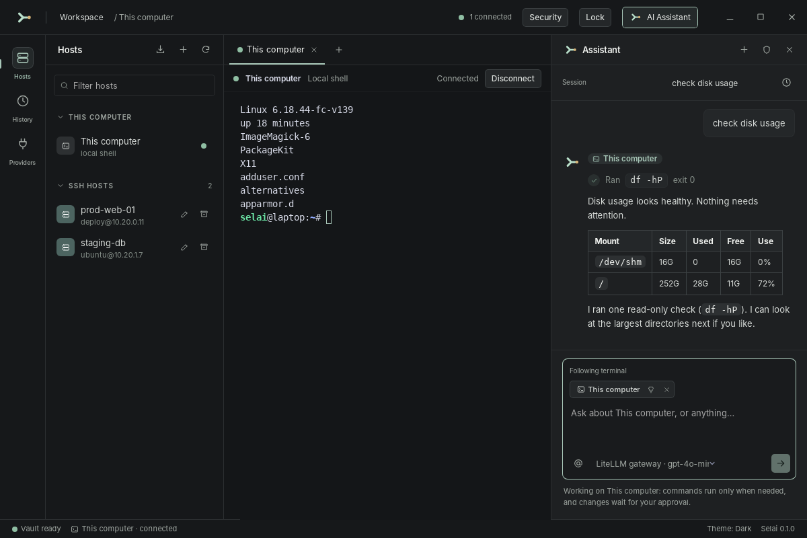

<p align="center"></p>

<h1 align="center">Selai</h1>

<p align="center"><strong>A desktop SSH workbench with a host-scoped AI assistant.</strong><br>
Terminals, an AI chat, and command history in one app. You choose where the assistant may work, and every change waits for your approval.</p>

<p align="center">
  
  
  
  
</p>

<p align="center">
  <a href="#screenshots">Screenshots</a> ·
  <a href="#features">Features</a> ·
  <a href="#get-started">Get started</a> ·
  <a href="#build-from-source">Build</a> ·
  <a href="#documentation">Docs</a>
</p>

<p align="center">
  <picture>
    <source media="(prefers-color-scheme: light)" srcset="docs/screenshots/workspace-light.png">
    
  </picture>
</p>

Selai brings SSH hosts, terminal tabs, an AI chat, and command history into one
desktop app. You choose the machine the assistant may work on. Routine
diagnostics use fixed commands; other commands need your approval before they
run. SSH credentials stay in your passphrase-protected local vault and are
never included in requests to an AI provider.

- **You choose the machine.** A task is bound to the servers you select, or to
  This computer. The model cannot move it to another host.
- **Nothing changes without you.** Fixed diagnostics run on their own. Any other
  command shows its exact text and target, and waits for your approval.
- **Credentials stay local.** Passwords, private keys, and sudo passwords never
  reach the AI provider. They live in an encrypted vault that one passphrase unlocks.
- **Everything is recorded.** Each request, command, outcome, and token count is
  saved to History, with an audit record written before remote execution.

> **Version 0.1.0 is a preview.** The core SSH and agent flows have been tested
> end to end on Linux with an OpenSSH fixture and a local mock AI provider.
> Windows and macOS SSH use, installer runs, and live provider integrations have
> not been verified by the maintainers. See [current milestone evidence](docs/release/milestones.md)
> and [known security limits](SECURITY.md) before using Selai with sensitive
> systems.

## Screenshots

<table>
  <tr>
    <td width="50%" valign="top">
      
      <br><strong>Approve before it runs</strong><br>
      A command that is not a fixed diagnostic shows its exact text and target. Root requests are marked, and a sudo password goes to the machine, never to the model.
    </td>
    <td width="50%" valign="top">
      
      <br><strong>Replies that read well</strong><br>
      Markdown, tables, and Mermaid diagrams render in the chat. Chat with no server selected runs nothing and contacts no host.
    </td>
  </tr>
  <tr>
    <td width="50%" valign="top">
      
      <br><strong>History you can audit</strong><br>
      Open a session to see its requests, the commands that ran on each server, their status and exit codes, and token usage.
    </td>
    <td width="50%" valign="top">
      
      <br><strong>Bring your own model</strong><br>
      Use OpenAI, Anthropic, or a compatible gateway. <strong>Test</strong> checks a real tool-call round trip before a provider can work on a server.
    </td>
  </tr>
  <tr>
    <td width="50%" valign="top">
      
      <br><strong>Encrypted vault</strong><br>
      One passphrase protects hosts, credentials, chat, and history on this computer. Selai generates a separate recovery key during setup.
    </td>
    <td width="50%" valign="top">
      
      <br><strong>Dark, light, or system</strong><br>
      Switch the theme from the status bar. Chats are saved as named sessions you can search and reopen.
    </td>
  </tr>
</table>

<sub>Screenshots use sample hosts and a mock AI provider.</sub>

## Features

| Area | What you can do |
| --- | --- |
| **SSH hosts** | Add, edit, filter, and archive profiles; use password or local private key authentication; save a host and connect in one flow. Labels can contain spaces. |
| **Host verification** | Inspect and explicitly trust a fingerprint on first connection. A changed host key blocks connection until you confirm its replacement. |
| **Terminal** | Open interactive SSH terminals in tabs, resize them, adjust the terminal font with Ctrl+Plus or Ctrl+Minus, see connection and exit status, reconnect, and edit a host after a failed login. Open a terminal for **This computer** too. |
| **AI chat** | Discuss a question without a server, or bind a task to one or more SSH hosts or This computer. Mention hosts with `@` for one message to run independent tasks in parallel, follow the focused terminal, or pin a server in the chat. Each host has its own output and change approvals. Assistant replies render Markdown, tables, task lists, code blocks, and Mermaid diagrams. |
| **Command control** | Fixed diagnostic commands may run without a prompt. Every free-form command needs approval for the exact command and host. Denied, expired, and interrupted work is not replayed automatically. |
| **Providers** | Configure OpenAI Responses, OpenAI Chat Completions and compatible endpoints, or Anthropic Messages. Check an API key, choose or enter a model ID, and test a real tool-call round trip. |
| **History** | Search saved AI sessions by title, then open a session to review its requests and command executions across servers, including status, exit codes and stored output. Browse by host for older tasks, provider token counts, timeline filters, encrypted history exports and output retention. |
| **Profile import** | Review and map CSV or plaintext JSON SSH profiles, select valid rows, and import them without replacing existing hosts. Use a shared CSV template for exports from other tools. |
| **Workbench** | Use the host explorer, terminal and History/Providers tabs, and the assistant side by side. Toggle the right-hand Assistant panel from the header and drag its divider to give it more room. The window controls are integrated into the workbench header. Choose dark, light, or system theme. |
| **Encrypted vault** | Protect credentials, managed private keys, host metadata, chat, and history with one passphrase. Use automatic locking, a separate recovery key, encrypted backup/restore, and encrypted history exports. |

### SSH hosts and terminals

Create a profile with a label, address, port, username, and authentication
method. Passwords and key passphrases are saved inside the encrypted vault;
for key authentication, select a local file whose contents Selai imports into the vault. The original file remains outside Selai and needs its own protection. Selai asks you to
trust an unknown server key *before* sending credentials. It refuses a changed
key until you inspect and explicitly replace the saved fingerprint.

Each terminal tab stays bound to its host. The host explorer also includes
**This computer** for a local terminal. Terminal tabs report connection state
and exit status, and offer a reconnect action. If login fails, you can open the
host editor from the error flow.

With a terminal focused, press **Ctrl+Plus** or **Ctrl+Minus** to change its font
size. The setting applies to all terminal tabs and is remembered when Selai
restarts.

### Assistant and approvals

The assistant has two useful modes:

1. With **No server** selected, chat is a multi-turn conversation with no
   command tools. No host is contacted. Messages from the selected session
   are sent to the configured AI provider.
2. With servers selected, a message starts an independent task on each server in parallel. Use
   the `@` picker for one or more hosts, or use the server associated with the
   focused terminal. You can pin a server while switching tabs. The model
   cannot switch the task to a different host.

Chats are saved as named sessions in Selai's local SQLite database. Edit the
**Session** title to describe the work, use **New session** to start a separate
conversation, and open **Session history** to search and reopen earlier chats.
An initial title is generated from the first request. Each session keeps its own
conversation context; live replies continue in their original session while you
work in another. The latest session opens again after restarting Selai. Reopening
history displays previous commands and decisions without executing them again;
unfinished runs are marked as detached and old approval controls are inactive.
Credential input fields, including sudo passwords, are excluded from the saved
transcript. Session transcripts are limited to 2 MB and 1,000 task replies.

Assistant replies support GitHub Flavored Markdown, including headings, lists,
tables, task lists, links, and fenced code blocks. A fenced `mermaid` block is
rendered as a diagram; if its syntax is invalid, Selai shows the source instead.
Links appear as text with their destination for copying. Remote images and raw
HTML from model replies are not loaded or executed in the app.

For example, select a configured provider, type `@`, choose **Production Web**
from the picker, and ask it to `check disk usage`. Selai can run its fixed disk
diagnostic and show the result. If the assistant proposes a free-form command,
an approval card shows the exact
command, target, and expiry. You can approve or deny it. A request for root
access is handled through `sudo`; the sudo password goes to that machine's
prompt, never to the model. The same approval rules apply to **This computer**,
where an approved command runs with your local user account's access.

Command output is available in **History**, along with the task, outcome, and
token usage. Selai stores bounded, pattern-redacted output previews and an
audit record before remote execution. Redaction can miss sensitive content, so
review what a task may expose before using a cloud provider.

### AI providers

Add a provider and its base URL, API key, and model. **Check API key** queries
the endpoint for available models; you can also enter a model ID manually.
**Test** checks connectivity and whether the selected model completes a tool
call and receives a tool result. Provider keys are stored inside the encrypted
vault. HTTPS is required for remote endpoints unless you explicitly enable
plain HTTP for a trusted gateway; loopback HTTP is allowed.

The provider receives chat messages and, during a server task, bounded and
redacted command results. See [Security](SECURITY.md) for the data flow and
limits. Built-in adapters have been exercised against mock servers; no live
OpenAI, Anthropic, or compatible service has been verified for this preview.

### Import SSH profiles

Open **Hosts -> Import SSH profiles**. Select a `.csv`, plaintext `.json`, or password-protected `.kdbx` file, review the detected column mapping and preview, select rows, and import. The drawer provides a downloadable CSV template. It recognizes common host columns, Bitwarden login entries with `ssh://` or `sftp://` URIs, compatible host-list JSON such as Termius API Bridge-shaped host objects, and Passbolt exports. KDBX vaults are decrypted locally after entering the passphrase; only entries with `ssh://` or `sftp://` URLs are included. Selai skips non-SSH entries and existing labels or matching host/port/username combinations, and reports failures per row.

The preview hides passwords. Imported passwords and key passphrases use the same encrypted vault as a manually added host. Notes are excluded by default to avoid retaining unnecessary information. Importing inline private key contents and connecting directly to another manager are not supported; supply a path to a local key file and Selai imports its contents into the vault. CSV/JSON imports are limited to **2 MB**, KDBX files to **10 MB**, and both to **500 profiles**. Import does not connect to a server or trust its host key. The source export remains wherever you saved it; handle a plaintext export as a file containing secrets. See the [format and vendor examples](docs/import-ssh-profiles.md).

### Vault setup, locking, and recovery

On first start, choose and confirm a passphrase of at least **12 characters**.
Paste is supported. Save the separately generated recovery key before opening
the workspace. Neither the passphrase nor an unwrapped encryption key is saved
in Credential Manager. Losing both your passphrase and recovery key means the
vault cannot be recovered.

For an existing installation, close every older Selai instance first. Setup
migrates the old database, saved OS credentials, readable private key files,
and JSON history exports. It verifies the encrypted database before committing
the vault and removing migrated copies. Changed or inaccessible source files
are kept; **Security** shows pending cleanup and offers a retry. Old exports
remain accessible under **Security → Migrated history exports**. Missing private
key files remain external references until you replace them with an available file.

Unlock once each time Selai starts. **Lock** in the header closes terminal
connections and stops admission of new commands. With active work you can let
the current command finish, or cancel immediately. The workspace is hidden
while work drains; it is reported locked only after the database closes and the
vault key is dropped. A disconnected remote command may still run on its server;
Selai never replays it automatically. Reopening chat history restores the latest
session without executing its commands; terminal connections must be reopened.

Auto-lock defaults to **15 minutes**; choose 5, 15, 30, or 60 minutes in
**Security**. Keyboard, pointer, and scrolling input in Selai reset the timer;
passive terminal output and AI replies do not. Windows session lock and
suspend/resume notifications also request locking. Automatic OS session lock
integration on Linux and macOS is not implemented in this release.

**Security** also lets you change the passphrase, replace the recovery key, and
save an encrypted `.selai` backup. Restore with the backup's passphrase or its
recovery key through the setup screen in a fresh
Selai data directory; existing vaults are not overwritten. Backups and history
exports retain the passphrase/recovery key from when they were created. Changing
the current passphrase does not invalidate older copies.

History exports now use `.selai-history` and are encrypted by default. The
explicit **Decrypt a history export** action saves readable JSON after you enter
the export's passphrase and choose a destination outside Selai's app directory.
Plaintext JSON and recovery-key downloads need separate protection.

To restore on the same Windows computer, close Selai and preserve its current
data folder (`%APPDATA%\dev.selai.desktop`) under another name before restarting.
The new setup screen can restore a backup without replacing the preserved data.
Keep the old folder until you have verified the restored hosts and history.

## Get started

### Install a preview build

If a build is available, download it from [GitHub Releases](https://github.com/f3ci/selai/releases)
or the **Release packaging** workflow artifacts. The workflow is configured to
produce these packages:

| Platform | Package |
| --- | --- |
| Windows x64 | `.exe` setup or `.msi` |
| Linux x64 | `.deb` or `.AppImage` |
| macOS Apple silicon | `.dmg` |

Check the downloaded file against its accompanying `SHA256SUMS`. Linux needs a
Secret Service keyring such as GNOME Keyring or KWallet. Signing and
notarization are optional in the release workflow; an unsigned build may be
blocked or warned about by Windows or macOS. The app has no automatic updater.
See [release packaging](docs/release/packaging.md) for build outputs, checksum
commands, signing status, and workflow instructions.

### First session

1. Open **Hosts**, add an SSH profile, and choose **Save & connect**.
2. Check the server fingerprint against a trusted source, then choose **Trust & connect**.
3. Use the terminal. Open more hosts in separate tabs if needed.
4. For AI features, open **Providers**, save a provider, choose a model, and run **Test**.
5. Open the assistant with **Ctrl+Shift+L**. Select a server or type `@` to
   choose a host for one message. Review any command approval before accepting.
6. Open **History** to inspect the task and command records.

**Ctrl+Shift+E** toggles the host explorer. The status bar lets you switch
between dark, light, and system theme.

## Build from source

You need **Node.js 22**, **pnpm 10**, the stable Rust toolchain, and the native
dependencies for Tauri 2 on your platform. On Linux, the CI workflow lists the
system packages used for WebKitGTK, the keyring, and OpenSSH tests.
SQLCipher and OpenSSL are built from source. Install Perl and a C toolchain;
Windows additionally needs NASM, the Visual Studio C++ build tools, and the Windows SDK.

```sh
cd apps/desktop
pnpm install --frozen-lockfile
pnpm tauri dev
```

Run the frontend checks from `apps/desktop`:

```sh
pnpm typecheck
pnpm lint
pnpm test
pnpm build
```

Run Rust checks from the repository root:

```sh
cargo fmt --all -- --check
cargo clippy --workspace --all-targets --locked -- -D warnings
cargo test --workspace --locked
```

The full Linux SSH test suite starts a real `sshd` and needs root and an
unlocked Secret Service. Use the harness and setup instructions in
[CONTRIBUTING.md](CONTRIBUTING.md). A desktop bundle can be built from
`apps/desktop` with `pnpm tauri build` once the platform's Tauri dependencies
are installed.

## Repository layout

| Path | Purpose |
| --- | --- |
| `apps/desktop` | The Tauri 2 app: React and TypeScript UI, plus the Rust commands behind it. |
| `crates/selai-domain` | Core IDs, state machines, error codes, and shared contracts. |
| `crates/selai-ssh` | SSH transport. |
| `crates/selai-agent` | The agent runtime for one scoped task. |
| `crates/selai-policy` | Policy for agent tool calls. |
| `crates/selai-llm` | Provider adapters. |
| `crates/selai-vault` | The passphrase-protected local vault. |
| `crates/selai-secrets` | Secret values and storage contracts. |
| `crates/selai-storage` | SQLite persistence and migrations. |
| `crates/selai-audit` | Redaction, bounded previews, and the audit hash chain. |
| `crates/selai-platform` | OS lock signals. |
| `crates/selai-testkit` | A real OpenSSH server for tests. Not part of the product. |

## Documentation

- [Import format and examples](docs/import-ssh-profiles.md)
- [Security model and disclosure policy](SECURITY.md)
- [Milestone status and test evidence](docs/release/milestones.md)
- [Installer packaging and verification](docs/release/packaging.md)
- [Vault validation](docs/release/vault-validation.md)
- [Architecture decisions](docs/adr/)
- [Contributing and local checks](CONTRIBUTING.md)

Selai is licensed under [Apache 2.0](LICENSE).
